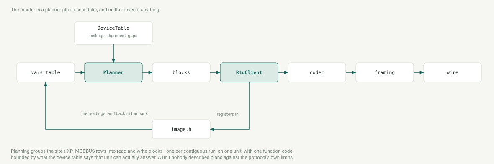

# Modbus {#dev_modbus}

<!-- source of truth: modbus/rtu/, modbus/tcp/, modbus/wire.h -->

## The four corners

## RTU framing

### The silent interval {#fr_silence}

## The field-bus master

### Ranking the plan {#dev_modbus_rank}

## The RTU slave

### Framing {#sl_framing}

## The TCP server

### Bounded work {#server_bounded}

### One beat {#server_beat}

### Acknowledgement {#server_ack}

## The TCP master
