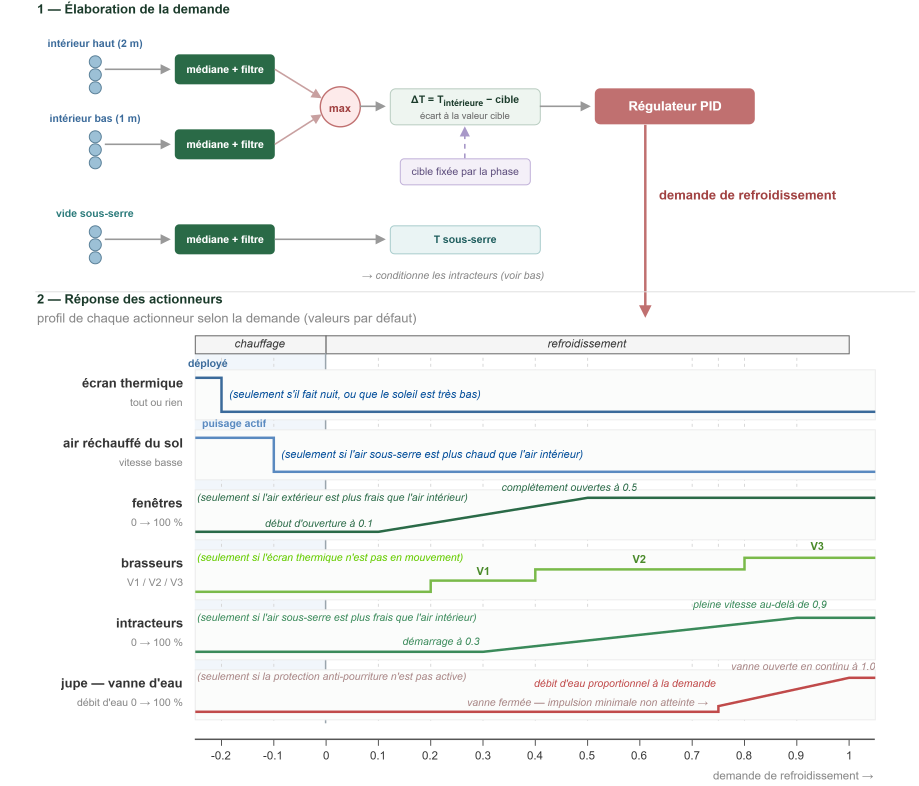
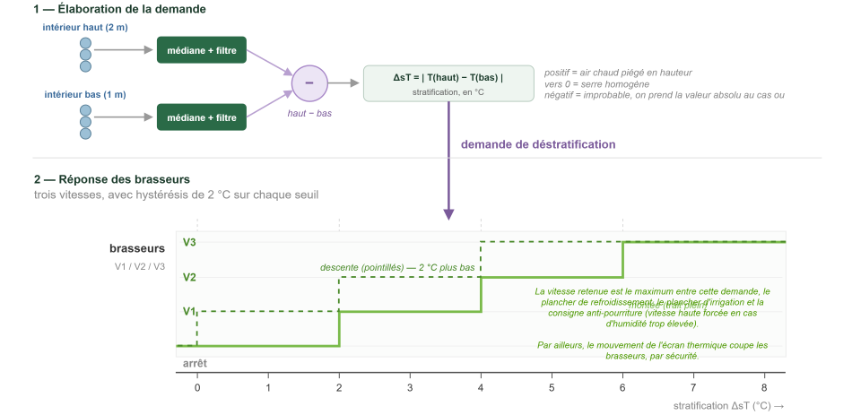
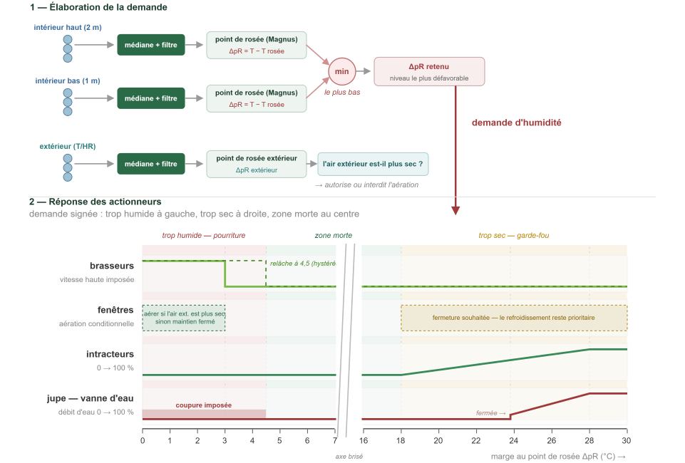

# Climate {#gh_mlb41_climate}

<!-- source of truth: src/sites/gh_mlb41/programs/climate/, rates in
     tables/programs.csv. Prose adapted from the spec's "Logique de contrôle"
     and "Logique de contrôle climatique"; every threshold below was checked
     against tables/params.csv. -->

Three ladders shape the climate, and they share a form: each reduces its
quantity to a demand, and the actuators arrange themselves along it. A phase of
the day sets the target and arms the ladder; the ladder decides how hard.

| ladder | acts on | measure | regulator |
|---|---|---|---|
| cooling | warming and cooling | dT degC, signed | PID plus trigger thresholds |
| destratification | stratification | dTstrat degC | 3-band hysteresis |
| humidity | condensation, or extreme dryness | dew-point margin degC | 4-band hysteresis with a dead zone |

Each rung normalises the same way:

    demand = clamp((value - low) / (high - low), 0, 1)

For the signed ladders - cooling and humidity - that form applies either side of
zero, a positive branch and a negative one, separated by a dead zone, giving a
demand between -1 and 1.

Irrigation has no ladder; it is modulated by a continuous measure of evaporative
power instead. See @ref gh_mlb41_irrigation.

## day_phase_controller

The day is cut into 6 phases, each defined as an interval in minutes before or
after sunrise or sunset.

After a hot day, the morning is allowed to give up a little temperature. Then,
in the early morning, a light breeze blows for a few minutes. The day runs. After
a cold night, the late afternoon is allowed to gain a little, then before sunset
a light breeze blows again, and the night runs.

| | phase | when | target | why |
|---|---|---|---|---|
| P1 | `PHASE_NIGHT` | after sunset | 20 degC | normal operation |
| P2 | `PHASE_COLD_BANK` | shortly before sunrise, only if the previous day was hot | 14 degC | pre-cool at the end of the night, so a typically hot day starts cooler |
| P3 | `PHASE_DAWN_BREEZE` | from sunrise to a few minutes after | 20 degC | the morning breeze, helping the plants cross from night to day |
| P4 | `PHASE_DAY` | until late afternoon | 20 degC | normal operation |
| P5 | `PHASE_HEAT_BANK` | late in the day, until shortly before sunset | 27 degC | bank heat at the end of the day, so a typically cold night starts warmer |
| P6 | `PHASE_DUSK_BREEZE` | until sunset | 20 degC | the evening breeze, from day to night |

`COLD_BANK` and `HEAT_BANK` are conditional, and each has parameters for its
length, its trigger and its effect on the target.

## target_temp_controller

In normal operation - NIGHT, DAY, DAWN_BREEZE, DUSK_BREEZE - the cooling target
is the base value, `cli_coolSet_degC`, 20 degC by default, and the ladder works
on `dT = T - target`.

The two banking phases shift that target and then clamp it:

    COLD_BANK: target = max(cli_coolSet_degC - cli_coldBankOfs_degC, cli_targetMin_degC)
    HEAT_BANK: target = min(cli_coolSet_degC + cli_heatBankOfs_degC, cli_targetMax_degC)

The floor `cli_targetMin_degC` (14 degC) and the ceiling `cli_targetMax_degC`
(27 degC) guarantee that banking never pushes the greenhouse to a dangerous
temperature, however aggressively the offsets are set.

Both phases are conditional on what yesterday did:

- **COLD_BANK** arms only if the previous day's high went above
  `cli_coldBankTrg_degC` (24 degC);
- **HEAT_BANK** arms only if the previous night's low fell below
  `cli_heatBankTrg_degC` (10 degC).

So the greenhouse pre-cools before dawn only after a hot day, and banks heat in
the late afternoon only after a cold night. A clear late-spring day can trigger
**both** - hot day, cold night - and they are handled independently.

`cli_targetTau_s` (300 s) smooths the target so a phase change does not step it.

## The thermal screen

The screen is driven by negative cooling demand, past
`cli_thermalScreenDem` (-0.2), but whether it may move at all depends on the
phase. The phase gives permission; the demand decides the wanted movement.

| phase | the screen may |
|---|---|
| `NIGHT`, `DUSK_BREEZE`, `HEAT_BANK` | **deploy** |
| `DAY`, `DAWN_BREEZE`, `COLD_BANK` | **retract** |

The rule follows the direction of the day: the screen may deploy when the night
is coming or heat is being kept, and retract when the day is coming or the house
is being pre-cooled. A passing call for heat in the middle of a cold day
therefore never closes the screen against the sun, and a mild night never
reopens it and loses the heat it was holding.

When the demand asks for a movement the phase forbids, the screen stays where it
is and the thermal need is met, if at all, by drawing warm air from the ground
through the intake fans.

## cooling_controller

Every process on this ladder shares one path: get the hot air out, replace it
with cooler air from under the floor. The ladder also has a slight heating role,
because when the demand goes negative the intake fans run slowly so that
incoming air is warmed by the ground, and when it goes further negative the
thermal screen is allowed to deploy.

A PID sets the cooling effort from the conditions, and the equipment arranges
itself along it. In the shipped configuration:

| demand | what happens |
|---|---|
| below `cli_thermalScreenDem` (-0.2) | the thermal screen deploys, at night or with the sun low |
| below `cli_groundHeatDem` (-0.1) | intake fans run slow with the windows shut, only if the crawlspace air is warmer than the greenhouse |
| above `cli_windowStartDem` (0.1) | the windows begin to open |
| above `cli_fanLowDem` (0.2) | the circulation fans start at speed 1 |
| above `cli_intakeStartDem` (0.3) | the intake fans start, only if the crawlspace air is cooler than the greenhouse |
| above `cli_fanMedDem` (0.4) | the circulation fans go to speed 2 |
| above `cli_windowFullDem` (0.5) | the windows are fully open |
| above `cli_skirtCoolDem` (0.7) | the crawlspace skirt is wetted - in practice a little above, because the valve has a minimum command interval |
| above `cli_fanHighDem` (0.8) | the circulation fans go to speed 3 |
| above `cli_intakeFullDem` (0.9) | the intake fans reach full speed |

Every threshold is a parameter and can be moved without reprogramming, though a
good deal of modelling went into them. The estimate is that outside temperatures
up to 35 degC are manageable without risk to the plants, and that days above
40 degC remain dangerous.

@note The two associated alarms, `alarm_too_hot` and `alarm_too_cold`, sit above
and below the standby heating and cooling systems. They mean the greenhouse has
left the margins it is allowed, not that a ladder is working hard.

@note The PID's P/I/D terms - `cli_coolKp`, `cli_coolTi_sec`, `cli_coolTd_sec` -
are set during commissioning. They are hard to determine and need a rigorous
approach: real tests, then Ziegler-Nichols or Lambda-T.

## destrat_controller

A simple three-band regulator with hysteresis on the gap between the high and
low interior temperatures: `cli_dTStratLow_degC` (2 degC),
`cli_dTStratMed_degC` (4 degC) and `cli_dTStratHigh_degC` (6 degC) select fan
speeds 1, 2 and 3. After a speed change the gap must move by
`cli_dTStratHyst_degC` before the speed may change again, which keeps the fans
from hunting.

@note The spec gives that hysteresis as 2 degC; the shipped default is 1 degC.

Given the fans installed and the air volume, stratification should always be
controllable.

The fans are positioned to pull air from the bottom upward, in summer as in
winter. That looks wrong at first, but the plants are too close to the fans:
blowing air straight at them in summer would dry them too fast and put them in
danger. To spread the flow properly, deflectors are needed above each fan, one
per fan, to push the air out toward the sides of the greenhouse. Getting the
shape right would properly need a dynamic simulation; that costs more than this
project can carry, so intuition it is. Papier mache under resin is the current
thought, and not yet settled.

## humidity_controller

Rot and condensation are among the main risks to *Haworthia*. More precisely,
two things: permanent moisture around the roots, which favours fungal growth,
and permanent moisture on the plant itself, which stops it breathing properly.
It matters more for plants using crassulacean acid metabolism - the stomata open
only at night, and it is at night that the risk of moisture and condensation is
highest. In the day, water loss is limited because the stomata are closed.

Several principles limit that:

- night watering happens only in dry conditions; in humid conditions it moves to
  the start of the day, so the tray has time to dry before night;
- at sunset a light breeze circulates to evaporate any moisture on the plants
  before their stomata open, which helps them breathe at night;
- at sunrise a light breeze circulates to evaporate the condensation left on the
  leaves by the morning dew;
- when humidity is high, internal ventilation is increased and wetting the skirt
  is forbidden;
- when the outside is more humid than the inside, ventilation is limited;
- when humidity is too low, the skirt is wetted and the intake fans run.

The ladder itself is a four-band regulator with hysteresis and a dead zone,
aiming at a range of dew-point margin in which the plants are comfortable
without developing rot:

| dew-point margin | what happens |
|---|---|
| below `cli_dehumFull_degC` (3 degC) | dehumidifying at full - fans at full power |
| below `cli_dehumStart_degC` (4.5 degC) | dehumidifying starts - fans at low power |
| above `cli_humidStart_degC` (18 degC) | humidifying starts - the skirt is wetted, air comes in at low rate |
| above `cli_humidFull_degC` (28 degC) | humidifying at full - air at full rate through the wetted skirt |

`cli_rotMargin_degC` (1 degC) is the margin below which the rot lockout takes
hold, and `cli_rotRelease_sec` (300 s) how long it runs on past the condition.

@note A standalone dehumidifier sits alongside this, and only comes on in the
most extreme cases.

### Modulating the skirt

The skirt valve is all-or-nothing; it cannot meter water. To adjust the amount
anyway it is driven on a duty cycle: over a fixed period, the valve stays open
for a fraction of the time proportional to the humidifying demand.

At the trigger the duty is near zero - the skirt barely wets - and at maximum
demand the valve stays open continuously.

The valve respects a minimum on-time, to avoid short cycles that would wear the
solenoid and cause water hammer. So when the asked-for duty is below
minimum-on over period, the valve stays shut rather than produce a micro-pulse.
That small dead zone at the bottom of the range does not matter: wetting the
skirt is a guard against extreme dryness, not a precision adjustment.

## intake_gates

The permissions the intake fans answer to: whether the crawlspace air is
actually cooler than the greenhouse before drawing it in for cooling, and
whether it is warmer before drawing it in for heat.

## intake_dry_gate

The lockout that forbids wetting the skirt when the air is already too humid.
