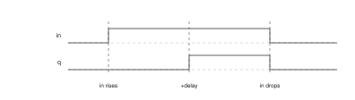
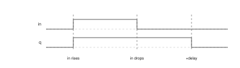
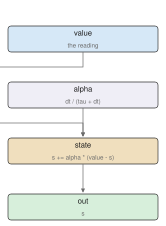
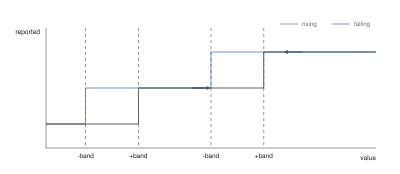
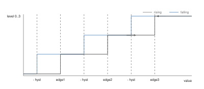
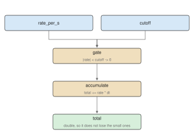
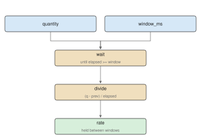
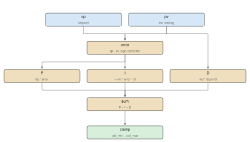
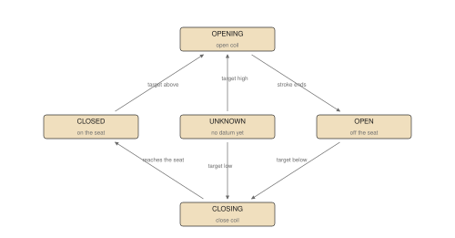

# Writing control programs {#int_st}

## Programs

### A program is one file

### Declaring what it reads and writes

### Opting into health

### Opting into parking

### Opting into quality

## Standard library

### Functions

### Blocks

<!-- One subsection per FUNCTION_BLOCK declared under plc/blocks/, in source-file
     order: timers, filters, analog, meter, pid, actuator. BAND_LATCH and DC_RAIL
     have no diagram. The drawings are named for the C++ blocks the ST replaced,
     hence block_Ton.drawio.svg under TON_MS. -->

### TON_MS

### TOF_MS

### EWMA

### DEADBAND

### STAIRCASE3

### BAND_LATCH

### DC_RAIL

### INTEGRAL

### DERIVATIVE

### PID

### ACTUATOR

